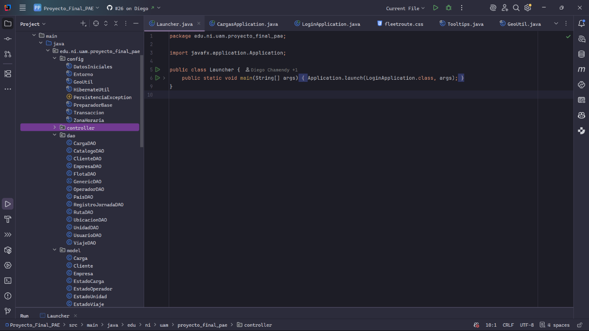
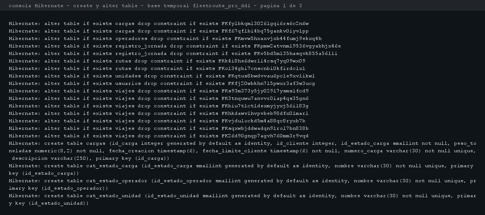
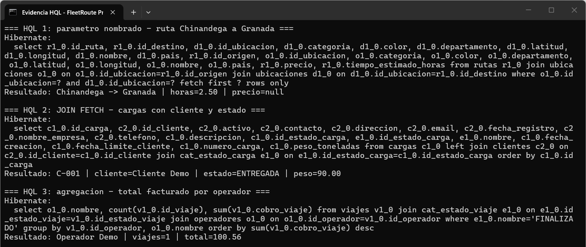
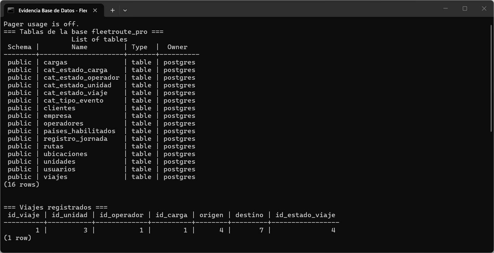
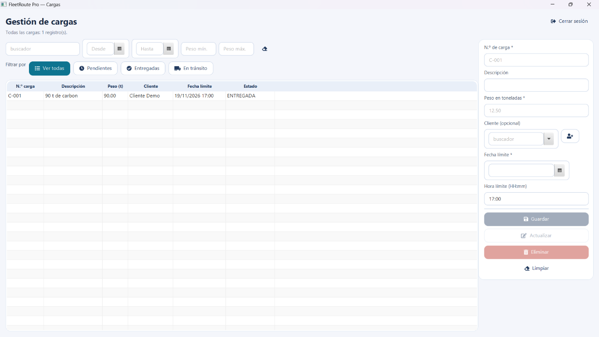

# FleetRoute Pro


> **Sistema de Despacho de Cargas, Control de Jornadas y Encadenamiento de Rutas**

Proyecto final de la asignatura **PAE — Programación de Aplicaciones de Escritorio** · 2026

---

## Información importante del entorno

- **JDK:** el proyecto compila con **Java 17 o superior** (probado con JDK 21 y 25).
- **Base de datos:** se utiliza **PostgreSQL 14+** como sistema gestor de base de datos; el esquema tiene **17 tablas**.
- **Script de base de datos:** el repositorio incluye [`database/fleetroute_pro.sql`](database/fleetroute_pro.sql), con la creación de tablas, restricciones, triggers, índices, catálogos y datos de ejemplo.
- **Extensión:** el script crea `pgcrypto` para generar los hashes BCrypt de los usuarios de demostración.
- **Conexión a la base de datos:** se realiza mediante un archivo **`.env`**. Cada integrante mantiene su propio archivo `.env` en su equipo con sus credenciales locales de PostgreSQL (usuario, contraseña, puerto, etc.). Este archivo **no se sube al repositorio**.
- **Archivo de ejemplo:** se incluye **`.env.example`** como plantilla. Cualquier persona que descargue el proyecto debe copiarlo, renombrarlo a `.env` y colocar en él sus propias credenciales.
- **API y cabina web:** el módulo `api-operador/` publica la API REST y la vista web del operador en `http://localhost:8080`. Usa la misma base PostgreSQL y requiere `OPENROUTESERVICE_API_KEY` para la navegación turn-by-turn.
- **Acceso desde otros dispositivos:** se puede publicar con Cloudflare Quick Tunnel. La app de escritorio incluye el botón **Iniciar Conexión** en la vista de flota: arranca la API si todavía no responde en `localhost:8080`, abre el túnel, muestra el estado con un punto de color y copia el enlace público con un clic en el icono de cadena. Para que el botón pueda arrancar la API, el JAR debe estar compilado una vez y la app debe ejecutarse con **JDK 21 o superior**.

---

## Tabla de contenido

- [Descripción general](#descripción-general)
- [Integrantes](#integrantes)
- [Stack tecnológico](#stack-tecnológico)
- [Funcionalidades por rol](#funcionalidades-por-rol)
- [Requerimientos funcionales](#requerimientos-funcionales)
- [Requerimientos no funcionales](#requerimientos-no-funcionales)
- [Reglas de negocio](#reglas-de-negocio)
- [Arquitectura del proyecto](#arquitectura-del-proyecto)
- [Modelo de datos](#modelo-de-datos)
- [Decisiones de diseño](#decisiones-de-diseño)
- [Explicación del ORM y las transacciones](#explicación-del-orm-y-las-transacciones)
- [Requisitos previos](#requisitos-previos)
- [Instalación y ejecución](#instalación-y-ejecución)
- [API y cabina web del operador](#api-y-cabina-web-del-operador)
- [Datos de ejemplo](#datos-de-ejemplo)
- [Variables de entorno](#variables-de-entorno)
- [Flujo de uso](#flujo-de-uso)
- [Módulo de jornada, cabina y monitor de flota](#módulo-de-jornada-cabina-y-monitor-de-flota)
- [Solución de problemas](#solución-de-problemas)
- [Evidencias](#evidencias)
- [Documentación](#documentación)

---

## Descripción general

**FleetRoute Pro** es una aplicación de escritorio orientada a empresas de transporte de carga pesada. Permite a la administración planificar, despachar y encadenar viajes en carretera, optimizando los tiempos de traslado, supervisando el cumplimiento de las horas de descanso contractuales de los choferes y controlando las fechas límite de entrega pactadas con los clientes.

> **Alcance:** este software **no es un inventario**. No gestiona almacenes ni stock de repuestos. Su enfoque es 100 % operativo: control de logística de viajes, horas de fatiga, conductores y cumplimiento de plazos de flete.

---

## Integrantes

| # | Estudiante                      |
|---|---------------------------------|
| 1 | Diego Marcello Chamendy Chow    |
| 2 | Carlos Eduardo Rodríguez Flores |
| 3 | Jose Augusto Salgado Murillo    |
| 4 | Roberto Fabio Tercero           |

---

## Stack tecnológico

| Componente | Tecnología |
|------------|------------|
| Lenguaje base | Java 17+ (probado con JDK 21 y 25) |
| Interfaz gráfica | JavaFX + FXML |
| Cabina web | HTML, CSS y JavaScript · MapLibre GL JS |
| API REST | Spring Boot 4.1 · Spring Web MVC · Spring JDBC |
| Navegación web | OpenRouteService Directions API |
| Acceso a datos | Hibernate ORM 6 (JDBC por debajo) · Patrón DAO |
| Base de datos | PostgreSQL |
| Gestión de dependencias | Maven |
| Configuración | Archivo `.env` (variables de conexión y ORS) |
| Seguridad | Contraseñas con hash BCrypt, sesiones Bearer y acceso por rol |
| Acceso externo | Cloudflare Quick Tunnel (HTTP/2 sobre TCP) |
| Arquitectura | Capas: Vista → Servicios → DAO → Modelo; API por capas |

> **Nota de stack:** la rúbrica de entrega exige mapeo ORM con JPA y operaciones de persistencia con Hibernate. Por eso el acceso a datos se implementa con Hibernate ORM sobre el driver JDBC de PostgreSQL, manteniendo el patrón DAO.

---

## Funcionalidades por rol

Ambos roles inician sesión con credenciales almacenadas en la base de datos; las contraseñas se guardan con hash BCrypt (RF-11 / RNF-04).

### Módulo Administrador (Despacho)

- **Planificador de asignaciones:** vinculación de unidad, operador y carga en un mismo viaje.
- **Pre-asignación de viajes:** encolamiento de la siguiente carga validando la consistencia geográfica de la ruta.
- **Monitor de flota en vivo:** tablero semaforizado con el estado de unidades, operadores y viajes activos.
- **Control financiero:** registro y consulta de la tarifa cobrada por cada flete, por operador y por unidad.
- **Gestión de unidades, operadores y cargas:** alta, consulta, actualización y baja.
- **Gestión de clientes:** pestaña con todos los campos de `clientes` (empresa, contacto, teléfono, email, dirección y activo), con validaciones y bajas protegidas por integridad referencial.
- **Panel administrativo:** cuentas de administradores y operadores, permisos de reportes, restablecimiento de contraseñas, países activos con buscador (cada país se agrega como una sola ubicación con un centro aproximado, sin provincias ni ciudades), ubicaciones editables con mapa satelital de solo lectura y rutas con tiempo estimado y precio sugerido. Incluye borrados masivos de cuentas filtradas, ubicaciones y rutas protegidos con la contraseña del administrador.
- **Alertas de operador:** pestaña **Alertas** con la ubicación, fecha y hora, operador, viaje/carga, unidad, mensaje y estado de cada emergencia enviada desde la cabina de escritorio o web.
- **Túnel de administración:** botón **Iniciar Conexión** junto a **Cerrar sesión**. Arranca la API si no responde, abre y detiene un Cloudflare Quick Tunnel, muestra un punto de estado (rojo, amarillo o verde) y un icono de enlace que copia la URL pública al portapapeles.
- **Lugares exactos para viajes:** al elegir origen/destino se abre un selector con búsqueda Nominatim y mapa Leaflet. Se puede buscar una referencia, mover el mapa y hacer clic en el punto exacto (por ejemplo, una casa cercana); el nombre para guardar es editable. El lugar se guarda en `ubicaciones` con país, nombre, latitud y longitud, por lo que puede reutilizarse al buscar ese país. El botón **Google Maps** abre la ubicación en el navegador.
- **Asistente de primera configuración:** en el primer arranque se capturan los datos de la empresa, la moneda con la que se muestran los cobros y se crea la cuenta de administrador, sin editar archivos ni buscar en la base de datos.

> La pestaña Ubicaciones incluye un mapa Leaflet satelital de solo lectura con los puntos de las ubicaciones registradas. Permite mover y ampliar el mapa, seleccionar un punto para centrarlo y ver su información; no permite crear ubicaciones haciendo clic en el mapa.
> El selector de lugares exactos usa Leaflet con mosaicos de OpenStreetMap (muestra calles, iconos y nombres de negocios y sitios a zoom alto), capa satelital de Esri y búsqueda Nominatim/OpenStreetMap; la búsqueda respeta el límite de 1 petición por segundo y requiere conexión a Internet.

### Módulo Operador (Cabina)

- **Interfaz tipo tableta:** botones grandes, alto contraste y pantalla simplificada para cabina.
- **Cronómetro digital:** horas conducidas y descanso acumulado en tiempo real.
- **Controles rápidos:** `INICIAR TRAYECTO`, `PAUSA`, `REANUDAR` y `CONFIRMAR ENTREGA`.
- **Panel de siguiente asignación:** vista previa de la carga encadenada que se activará al finalizar el viaje actual.
- **Cabina web:** misma lógica de jornada, alertas y cambio de contraseña desde el navegador; mapa inclinado MapLibre con seguimiento del vehículo, ruta real de OpenRouteService e indicaciones turn-by-turn. Consulta el panel cada 5 segundos y mantiene la sesión activa hasta 24 horas desde el último uso. Al ingresar solicita pantalla completa y, en navegadores móviles compatibles, bloquea la orientación horizontal. El diseño se adapta a PC, tablet y teléfono (dos columnas en horizontal, una con desplazamiento en vertical) y mantiene siempre visibles los botones de la jornada.

---

## Requerimientos funcionales

| Código | Requerimiento | Prioridad |
|--------|---------------|-----------|
| RF-01 | **Gestión de unidades (camiones):** registrar, consultar, actualizar y dar de baja unidades con número de unidad, placas, modelo y estado operativo. | Alta |
| RF-02 | **Gestión de operadores y reglas de descanso:** registrar operadores con sus datos personales, horas máximas de conducción y horas mínimas de descanso. | Alta |
| RF-03 | **Gestión de cargas y fecha límite (SLA):** registrar cargas con descripción, peso, número de carga y fecha límite pactada con el cliente. | Alta |
| RF-04 | **Asignación de viajes:** crear un viaje vinculando unidad disponible, operador y carga, definiendo origen, destino, tiempo estimado y cobro. | Alta |
| RF-05 | **Encadenamiento y validación geográfica:** pre-asignar el siguiente viaje validando que el origen del nuevo viaje coincida con el destino del actual. | Alta |
| RF-06 | **Registro de eventos de jornada:** iniciar trayecto, pausa de descanso, reanudar manejo y confirmar entrega, con timestamp real. | Alta |
| RF-07 | **Cálculo acumulativo de horas:** sumar horas efectivas de manejo y descansos fragmentados para validar las reglas contractuales. | Alta |
| RF-08 | **Alertas de fatiga y semáforo SLA:** alertas visuales de estado (a tiempo, descanso pendiente, retraso/SLA). | Media |
| RF-09 | **Transición automática de viajes encadenados:** al confirmar una entrega, el siguiente viaje se activa automáticamente en la pantalla del operador. | Alta |
| RF-10 | **Control financiero por viaje:** registrar el cobro de cada viaje y consultar el total facturado por operador y por unidad. | Media |
| RF-11 | **Autenticación y control de acceso por rol:** Administrador (oficina) u Operador (cabina), con credenciales validadas contra la base de datos. | Alta |
| RF-12 | **Monitor de flota en vivo:** tablero en tiempo real con estados semaforizados, filtrable por estado, unidad u operador. | Media |

---

## Requerimientos no funcionales

| Código | Descripción |
|--------|-------------|
| RNF-01 | **Rendimiento:** las operaciones principales deben responder en menos de 2 segundos en condiciones normales. |
| RNF-02 | **Usabilidad:** la interfaz del operador debe ser tipo tableta, con botones grandes y un máximo de 3 pasos por evento. |
| RNF-03 | **Compatibilidad:** ejecución sobre Java 17 o superior, JavaFX y PostgreSQL en una red LAN local. |
| RNF-04 | **Seguridad:** contraseñas almacenadas con hash, expiración de sesión por inactividad y acceso restringido por rol. |
| RNF-05 | **Integridad de datos:** claves foráneas, restricciones `NOT NULL` y validaciones `CHECK` en el modelo relacional. |
| RNF-06 | **Mantenibilidad:** arquitectura en capas (Vista JavaFX + Servicios + DAO + Modelo) con separación de responsabilidades. |
| RNF-07 | **Portabilidad:** ejecución en Windows, Linux y macOS sobre la JVM. |
| RNF-08 | **Disponibilidad y persistencia:** cada evento de jornada se registra de forma transaccional en PostgreSQL. |
| RNF-09 | **Escalabilidad:** índices en `id_operador`, `id_viaje` y `estado` para sostener el crecimiento del histórico. |
| RNF-10 | **Documentación:** modelo relacional, manual de usuario por rol y manual técnico de instalación y despliegue. |

---

## Reglas de negocio

1. **Descansos flexibles por contrato.** Cada operador tiene un límite de horas continuas de manejo y un tiempo total de descanso obligatorio. El chofer puede fragmentar sus descansos y el sistema acumula los tiempos para validar el cumplimiento.
2. **Encadenamiento estricto de rutas.** El administrador puede pre-asignar el siguiente viaje mientras la unidad sigue en ruta. El sistema exige que `origen_viaje_n+1 == destino_viaje_n`; si no se cumple, se bloquea la pre-asignación.
3. **Doble métrica de tiempos (manejo vs. SLA cliente).** El sistema separa el tiempo estimado de trayecto de la fecha límite contractual de la carga. Los retrasos se miden contra la fecha límite del cliente.
4. **Transición automática de despacho.** Al confirmar la entrega, la siguiente carga encadenada se activa automáticamente en la pantalla del operador, sin aprobaciones manuales.

Además:

- Una unidad en estado **En Ruta** no puede asignarse a un nuevo viaje.
- Solo se asignan unidades y operadores en estado **Disponible**.
- Al crear un viaje, la unidad y el operador pasan automáticamente a estado **En Ruta**.
- La fecha límite del cliente no puede ser anterior a la fecha actual; se valida con el trigger `trg_carga_fecha_limite`.
- La alerta de descanso se activa al superar el **80 %** de las horas máximas de conducción; al llegar al **100 %** la cabina registra una pausa automática y empieza a acumular descanso. Una pausa manual puede reanudarse sin esperar el total de horas.
- La alerta de SLA se activa cuando la proyección de llegada supera la fecha límite del cliente.
- Un operador con viajes registrados no se puede eliminar. Al eliminar un operador sin viajes, su cuenta de acceso se elimina en la misma operación.

### Restricciones aplicadas en PostgreSQL

- `unidades.modelo` es obligatorio; `capacidad_toneladas` es opcional.
- `operadores.horas_max_conduccion` y `horas_min_descanso` deben estar en el rango `(0, 24]`.
- `cargas.peso_toneladas > 0`, `viajes.tiempo_estimado > 0` y `viajes.cobro_viaje > 0`.
- `viajes.origen` y `viajes.destino` deben ser distintos y referencian `ubicaciones`.
- `viajes.fecha_fin` requiere `fecha_inicio`; `id_viaje_previo` no puede apuntar al mismo viaje.
- `registro_jornada` tiene `UNIQUE (id_viaje, num_evento)` y el trigger `trg_rj_num_evento` asigna el consecutivo.
- `usuarios` solo admite roles `ADMIN` u `OPERADOR`; un operador debe tener `id_operador` y su contraseña se guarda con hash BCrypt. La contraseña no se muestra en la interfaz; el administrador principal solo puede restablecerla.
- La asignación de unidad y operador se valida por estado en los servicios de despacho; no hay una tabla de autorización previa.

---

## Arquitectura del proyecto

El código sigue una arquitectura en capas con el patrón **DAO**, separando la interfaz, la lógica de negocio y el acceso a datos:

| Capa | Responsabilidad |
|------|-----------------|
| **Vista (JavaFX + FXML)** | Pantallas del administrador y del operador, controles y estilos. |
| **Controladores** | Manejo de eventos de la interfaz y comunicación con los servicios. |
| **Servicios** | Reglas de negocio: encadenamiento, cálculo de jornadas, alertas de fatiga y SLA. |
| **DAO** | Operaciones CRUD y consultas contra PostgreSQL (`ViajeDAO`, `OperadorDAO`, `CargaDAO`, `UsuarioDAO`, `ClienteDAO`, `UbicacionDAO`, entre otros). |
| **Modelo** | Clases de dominio: `Unidad`, `Operador`, `Carga`, `Viaje`, `RegistroJornada`, `Usuario`, `Cliente`, `Ubicacion`. |
| **Configuración** | `HibernateUtil`, transacciones y carga de variables desde el archivo `.env`. |
| **API REST** | `api-operador/`: controladores, servicios, seguridad con sesiones Bearer, acceso JDBC y validación de solicitudes. |
| **Cabina web** | Recursos estáticos servidos por Spring Boot: login real, panel del operador, mapa MapLibre, ruta ORS, alertas y cambio de contraseña. |

### Estructura del repositorio

```text
Proyecto_Final_PAE/
├── api-operador/               # API REST y cabina web del operador
│   ├── src/main/java/com/fleetroute/api/
│   │   ├── config/             # Seguridad, interceptor y manejo de errores
│   │   ├── controller/         # Endpoints REST
│   │   ├── dto/                # Contratos de entrada y salida
│   │   ├── security/           # Sesiones Bearer y límite de intentos
│   │   └── service/            # Jornada, panel, rutas, alertas y autenticación
│   ├── src/main/resources/
│   │   ├── static/             # index.html, app.js, styles.css y favicon
│   │   └── application.properties
│   └── src/test/               # Pruebas de cálculo y parseo de rutas
├── database/
│   └── fleetroute_pro.sql      # Esquema, catálogos, triggers y datos de ejemplo
├── evidencias/                 # Capturas de la entrega de Hibernate
├── src/
│   ├── main/
│   │   ├── java/edu/ni/uam/proyecto_final_pae/
│   │   │   ├── config/         # HibernateUtil, transacciones y lectura del .env
│   │   │   ├── controller/     # Controladores JavaFX
│   │   │   ├── dao/            # Acceso a datos (DAO)
│   │   │   ├── model/          # Entidades y catálogos
│   │   │   ├── security/       # Sesión y control de acceso
│   │   │   └── service/        # Reglas de negocio
│   │   └── resources/
│   │       ├── hibernate.cfg.xml   # Entidades registradas y configuración de Hibernate
│   │       └── edu/ni/uam/proyecto_final_pae/
│   │           ├── *.fxml          # Vistas FXML
│   │           └── styles/         # Hojas de estilo CSS
│   └── test/java/…             # Pruebas de JornadaService
├── .env.example                # Plantilla de variables de entorno
├── .env                        # Credenciales locales (NO se sube al repositorio)
├── .gitignore
├── pom.xml
└── README.md
```

### Configuración de Hibernate

La configuración está en `src/main/resources/hibernate.cfg.xml`, con las entidades del paquete `model` registradas mediante `<mapping class="..."/>` y `hibernate.hbm2ddl.auto=validate`. [HibernateUtil.java](src/main/java/edu/ni/uam/proyecto_final_pae/config/HibernateUtil.java) carga ese archivo, sobrescribe la URL, el usuario y la contraseña desde el `.env` local de cada equipo y mantiene un único `SessionFactory`. El archivo publicado solo incluye credenciales de ejemplo con el placeholder `CAMBIAR_PASSWORD`.

---

## Modelo de datos

La base de datos `fleetroute_pro` tiene **17 tablas**. El esquema completo, las restricciones, los índices, los triggers y los datos de ejemplo están en [`database/fleetroute_pro.sql`](database/fleetroute_pro.sql).

| Grupo | Tablas |
|-------|--------|
| Catálogos | `cat_estado_unidad`, `cat_estado_operador`, `cat_estado_carga`, `cat_estado_viaje`, `cat_tipo_evento` |
| Maestros | `clientes`, `ubicaciones`, `unidades`, `operadores` |
| Configuración | `empresa`, `paises_habilitados` |
| Acceso | `usuarios` |
| Operativas | `cargas`, `viajes`, `rutas`, `alertas_operador` |
| Bitácora | `registro_jornada` |

### Tablas principales

| Tabla | Campos principales | Función |
|-------|--------------------|---------|
| `empresa` | `id_empresa`, `nombre`, `ruc`, `telefono`, `email`, `direccion`, `moneda`, `pais`, `zona_horaria`, `fecha_configuracion` | Perfil de la empresa transportista; una fila creada por el asistente de primer arranque. |
| `clientes` | `id_cliente`, `nombre_empresa`, `contacto`, `telefono`, `email`, `direccion`, `activo`, `fecha_registro` | Catálogo de clientes para asociar cargas; se gestiona desde la pestaña Clientes. |
| `ubicaciones` | `id_ubicacion`, `nombre`, `departamento`, `pais`, `categoria`, `color`, `latitud`, `longitud` | Catálogo maestro de orígenes y destinos; las coordenadas permiten estimar el tiempo con la fórmula de Haversine y `categoria`/`color` definen el icono del marcador. |
| `unidades` | `id_unidad`, `numero_unidad`, `placas`, `modelo`, `capacidad_toneladas`, `seguro_vencimiento`, `revision_vencimiento`, `id_estado_unidad`, `fecha_registro` | Camiones y estado operativo; capacidad y vencimientos opcionales. |
| `operadores` | `id_operador`, `cedula`, `nombre`, `telefono`, `licencia_numero`, `licencia_categoria`, `licencia_vencimiento`, `contacto_emergencia`, `horas_max_conduccion`, `horas_min_descanso`, `id_estado_operador`, `fecha_ingreso` | Choferes, licencia y reglas de descanso. |
| `usuarios` | `id_usuario`, `username`, `password_hash`, `rol`, `id_operador`, `activo`, `es_principal`, `puede_ver_reportes`, `fecha_creacion` | Acceso al sistema con rol `ADMIN` u `OPERADOR`; el administrador principal gestiona cuentas, permisos y contraseñas. |
| `cargas` | `id_carga`, `numero_carga`, `descripcion`, `peso_toneladas`, `id_cliente`, `fecha_limite_cliente`, `id_estado_carga`, `fecha_creacion` | Envíos y SLA con el cliente. |
| `viajes` | `id_viaje`, `id_unidad`, `id_operador`, `id_carga`, `origen`, `destino`, `id_viaje_previo`, `tiempo_estimado`, `cobro_viaje`, `fecha_inicio`, `fecha_fin`, `id_estado_viaje`, `fecha_creacion` | Ruta, cobro y encadenamiento. |
| `paises_habilitados` | `id_pais_habilitado`, `nombre`, `fecha_activacion` | Países disponibles para crear ubicaciones; se administran con checkboxes desde el panel. |
| `rutas` | `id_ruta`, `id_origen`, `id_destino`, `tiempo_estimado_horas`, `precio` | Tiempo y precio sugerido entre dos ubicaciones; se usan al crear viajes y son editables desde el panel administrativo. |
| `registro_jornada` | `id_registro`, `id_viaje`, `num_evento`, `id_tipo_evento`, `fecha_hora`, `observacion` | Bitácora de eventos de la jornada. |
| `alertas_operador` | `id_alerta`, `id_viaje`, `id_operador`, `id_unidad`, `latitud`, `longitud`, `ubicacion`, `mensaje`, `fecha_hora`, `atendida` | Emergencias enviadas desde la cabina de escritorio o web; se consultan y marcan como atendidas en el panel administrativo. |

### Catálogos de estado

| Catálogo | Valores |
|----------|---------|
| `cat_estado_unidad` | `DISPONIBLE`, `EN_RUTA`, `MANTENIMIENTO` |
| `cat_estado_operador` | `DISPONIBLE`, `EN_RUTA`, `DESCANSO`, `INACTIVO` |
| `cat_estado_carga` | `PENDIENTE`, `ASIGNADA`, `EN_TRANSITO`, `ENTREGADA` |
| `cat_estado_viaje` | `PROGRAMADO`, `EN_CURSO`, `PAUSADO`, `FINALIZADO`, `CANCELADO` |
| `cat_tipo_evento` | `INICIO_TRAYECTO`, `PAUSA_DESCANSO`, `REANUDAR`, `CONFIRMAR_ENTREGA` |

> Los campos `id_estado_*` y `id_tipo_evento` son claves foráneas a estos catálogos; equivalen a los campos `estado` y `tipo_evento` del PDF, pero evitan texto libre.
>
> La interfaz puede mostrar estos valores en formato legible (por ejemplo, `EN_RUTA` como “En Ruta”). No hardcodees los IDs: consulta el catálogo por `nombre`.

### Relaciones principales

- `cargas.id_cliente` → `clientes.id_cliente` (opcional).
- `viajes.id_unidad` → `unidades.id_unidad`.
- `viajes.id_operador` → `operadores.id_operador`.
- `viajes.id_carga` → `cargas.id_carga`.
- `viajes.origen` y `viajes.destino` → `ubicaciones.id_ubicacion`.
- `viajes.id_viaje_previo` → `viajes.id_viaje` (auto-referencia para el encadenamiento).
- `rutas.id_origen` y `rutas.id_destino` → `ubicaciones.id_ubicacion` (par único origen/destino).
- `registro_jornada.id_viaje` → `viajes.id_viaje`.
- `registro_jornada.id_tipo_evento` → `cat_tipo_evento.id_tipo_evento`.
- `usuarios.id_operador` → `operadores.id_operador` (único y obligatorio para el rol `OPERADOR`).
- Las columnas `id_estado_*` referencian sus catálogos correspondientes.

### Triggers y automatizaciones

- **`trg_carga_fecha_limite`:** rechaza una `fecha_limite_cliente` anterior a la fecha actual al insertar o modificar una carga.
- **`trg_rj_num_evento`:** asigna `num_evento` de forma consecutiva por viaje. El aplicativo no necesita enviar ese valor; el trigger bloquea la fila del viaje para evitar duplicados en inserciones concurrentes.

> `viajes.origen` y `viajes.destino` almacenan el ID de la ubicación, no texto libre. Esto permite validar el encadenamiento comparando IDs.

---

## Decisiones de diseño

- **Cliente–Carga (1–N bidireccional):** `Cliente` expone la colección con `@OneToMany(mappedBy = "cliente", fetch = FetchType.LAZY)` y `Carga` es el lado dueño con `@ManyToOne` y `@JoinColumn(name = "id_cliente")`. El cliente es opcional en la carga. La relación se mantiene sincronizada con los métodos de ayuda `agregarCarga` y `quitarCarga` de `Cliente`.
- **Sin cascade en Cliente–Carga:** el cliente y sus cargas tienen ciclos de vida independientes; eliminar un cliente no debe borrar cargas históricas. La integridad se protege con la clave foránea y las validaciones del panel.
- **Usuario–Operador (@OneToOne):** la cuenta de acceso y el operador son entidades independientes; se enlazan solo desde `Usuario` con `@JoinColumn(name = "id_operador", unique = true)` y `@OneToOne(fetch = FetchType.LAZY)`. Tampoco se usa cascade: eliminar una cuenta no debe eliminar al operador ni su historial.
- **Carga de datos:** los catálogos pequeños (`estado`) se cargan con `EAGER`; las relaciones de dominio se dejan `LAZY` y los DAO las resuelven con `JOIN FETCH` antes de cerrar la sesión (por ejemplo, `CargaDAO`, `ViajeDAO` y `UsuarioDAO`). Así se evita `LazyInitializationException` sin convertir todo el modelo a `EAGER`.

## Explicación del ORM y las transacciones

Un ORM como Hibernate permite trabajar con objetos Java y evita escribir SQL manual para cada operación; Hibernate traduce las entidades y el HQL al SQL del motor y convierte los tipos automáticamente.
Una `Session` es una conversación corta con la base: se abre, se usa y se cierra con try-with-resources.
Una `Transaction` agrupa una o más operaciones; si todo termina bien se hace commit y, si ocurre una excepción, se hace rollback para no dejar datos a medias.
Los DAO abren la sesión y la transacción por cada operación, de modo que la interfaz no manipula conexiones directamente.
Las relaciones `LAZY` no se cargan hasta que se accede a ellas; si la sesión ya se cerró, aparece `LazyInitializationException`.
Para evitarlo, los DAO usan `JOIN FETCH` y traen la relación dentro de la misma consulta antes de cerrar la sesión.
Así el proyecto mantiene un único `SessionFactory` y separa la persistencia de la interfaz JavaFX.

---

## Requisitos previos

| Herramienta | Versión mínima | Notas |
|-------------|----------------|-------|
| JDK | **17 o superior** para escritorio; **21 o superior** para la API (probado con 21 y 25) | Debe estar configurado como SDK del proyecto. |
| Maven | 3.9 o superior | Gestiona JavaFX, Hibernate, Spring Boot y el driver JDBC de PostgreSQL. |
| PostgreSQL | 14 o superior | Servicio activo en `localhost:5432` (o el puerto configurado); probado con PostgreSQL 18.4. |
| Cuenta de OpenRouteService | Gratuita | Solo para la navegación turn-by-turn de la cabina web; se configura en `.env`. |
| Cloudflare Tunnel (opcional) | Última versión | Necesario solo para publicar la cabina fuera de la red local. |
| Git | Cualquier versión reciente | Para clonar el repositorio. |
| IDE (opcional) | IntelliJ IDEA / Eclipse | Recomendado para desarrollo y depuración. |

Las dependencias de JavaFX, Hibernate y el driver JDBC se descargan automáticamente mediante Maven; no es necesario instalar el SDK de JavaFX por separado.

> El script crea la extensión `pgcrypto` para generar los hashes BCrypt de los usuarios de ejemplo. El usuario de PostgreSQL debe tener permiso para crear extensiones; si no, un superusuario debe ejecutar `CREATE EXTENSION pgcrypto;`.

Descargas:

- Eclipse Temurin: <https://adoptium.net/>
- PostgreSQL: <https://www.postgresql.org/download/>

---

## Instalación y ejecución

### 1. Clonar el repositorio

```bash
git clone https://github.com/Thunderstrom11/Proyecto_Final_PAE.git
cd Proyecto_Final_PAE
```

### 2. Crear la base de datos

**Opción recomendada — que la aplicación la cree por usted.** No hace falta tocar `psql` ni pgAdmin. Instale PostgreSQL, anote la contraseña que eligió para el usuario `postgres` durante la instalación y ejecute la aplicación. En el primer arranque el asistente abre el paso **Conexión y base de datos**: escriba esa contraseña y pulse Siguiente. El sistema crea la base si no existe, aplica el esquema completo si está vacía y guarda la conexión en `.env`. Si la base ya tiene tablas con datos, el asistente no la modifica. Las opciones de abajo quedan como alternativa manual para desarrollo.

El script `database/fleetroute_pro.sql` crea las tablas, restricciones, índices, triggers, catálogos y datos de ejemplo. **Incluye `DROP TABLE`**, así que úsalo en desarrollo o haz un respaldo antes.

> Hibernate está configurado con `hibernate.hbm2ddl.auto=validate`: el esquema debe existir y coincidir con el SQL. Esto evita que la aplicación cree una versión más débil sin los CHECK, índices, triggers o restricciones de unicidad.

**Opción manual A — Línea de comandos (`psql`):**

```bash
psql -U postgres -c "CREATE DATABASE fleetroute_pro;"
psql -U postgres -d fleetroute_pro -v ON_ERROR_STOP=1 -f database/fleetroute_pro.sql
```

**Opción manual B — pgAdmin:**

1. Crear una base de datos llamada `fleetroute_pro`.
2. Abrir la base de datos y ejecutar el contenido de `database/fleetroute_pro.sql` desde el Query Tool.

**Si la base ya existía**, no ejecutes el script completo (borra las tablas). Aplica una sola vez estos cambios desde el Query Tool de pgAdmin para actualizarla:

```sql
BEGIN;

ALTER TABLE usuarios ADD COLUMN IF NOT EXISTS es_principal BOOLEAN NOT NULL DEFAULT FALSE;
ALTER TABLE usuarios ADD COLUMN IF NOT EXISTS puede_ver_reportes BOOLEAN NOT NULL DEFAULT FALSE;
ALTER TABLE usuarios DROP COLUMN IF EXISTS clave_visible;

ALTER TABLE ubicaciones ADD COLUMN IF NOT EXISTS latitud DOUBLE PRECISION;
ALTER TABLE ubicaciones ADD COLUMN IF NOT EXISTS longitud DOUBLE PRECISION;
ALTER TABLE ubicaciones ADD COLUMN IF NOT EXISTS categoria VARCHAR(20) NOT NULL DEFAULT 'Otro';
ALTER TABLE ubicaciones ADD COLUMN IF NOT EXISTS color VARCHAR(7) NOT NULL DEFAULT '#0891B2';
ALTER TABLE ubicaciones DROP CONSTRAINT IF EXISTS uq_ubicacion;
ALTER TABLE ubicaciones ADD CONSTRAINT uq_ubicacion UNIQUE (nombre, departamento, pais);

ALTER TABLE empresa ADD COLUMN IF NOT EXISTS moneda VARCHAR(3) NOT NULL DEFAULT 'NIO';

CREATE TABLE IF NOT EXISTS rutas (
    id_ruta               SERIAL PRIMARY KEY,
    id_origen             INT NOT NULL REFERENCES ubicaciones (id_ubicacion) ON DELETE RESTRICT,
    id_destino            INT NOT NULL REFERENCES ubicaciones (id_ubicacion) ON DELETE RESTRICT,
    tiempo_estimado_horas NUMERIC(6,2) NOT NULL CHECK (tiempo_estimado_horas > 0),
    CONSTRAINT uq_ruta_origen_destino UNIQUE (id_origen, id_destino),
    CONSTRAINT ck_ruta_distinta CHECK (id_origen <> id_destino)
);

CREATE TABLE IF NOT EXISTS alertas_operador (
    id_alerta      SERIAL PRIMARY KEY,
    id_viaje       INT NOT NULL REFERENCES viajes (id_viaje) ON DELETE CASCADE,
    id_operador    INT NOT NULL REFERENCES operadores (id_operador) ON DELETE RESTRICT,
    id_unidad      INT NOT NULL REFERENCES unidades (id_unidad) ON DELETE RESTRICT,
    latitud        DOUBLE PRECISION,
    longitud       DOUBLE PRECISION,
    ubicacion      VARCHAR(200),
    mensaje        VARCHAR(300),
    fecha_hora     TIMESTAMP NOT NULL DEFAULT NOW(),
    atendida       BOOLEAN NOT NULL DEFAULT FALSE
);

CREATE INDEX IF NOT EXISTS idx_alertas_fecha    ON alertas_operador (fecha_hora DESC);
CREATE INDEX IF NOT EXISTS idx_alertas_atendida ON alertas_operador (atendida);

UPDATE usuarios
   SET es_principal = TRUE,
       puede_ver_reportes = TRUE
 WHERE username = 'admin';

COMMIT;
```

> El script no crea la base de datos; solo el esquema y los datos. En Windows, si `psql` no se reconoce, agrega la carpeta `bin` de PostgreSQL al `PATH` o ejecuta los comandos desde la ruta de instalación.
>
> Si el usuario de PostgreSQL no puede crear la extensión `pgcrypto`, ejecuta `CREATE EXTENSION pgcrypto;` como superusuario antes de volver a correr el script.

### 3. Configurar las credenciales

Si usó la opción recomendada, el asistente ya escribió el `.env` con la conexión que usted indicó y puede saltar al paso 4.

Copia el archivo de ejemplo y renómbralo a `.env`:

**Windows (CMD):**

```bat
copy .env.example .env
```

**Linux / macOS:**

```bash
cp .env.example .env
```

Edita `.env` con los datos de **tu** instancia local de PostgreSQL:

```env
DB_URL=jdbc:postgresql://localhost:5432/fleetroute_pro
DB_USER=postgres
DB_PASSWORD=tu_contrasena
```

> Cada integrante debe crear su propio `.env` con sus credenciales. El archivo `.env` está incluido en `.gitignore` y **nunca debe subirse al repositorio**.

### 4. Compilar y ejecutar

```bash
mvn clean javafx:run
```

### 5. Primera ejecución (asistente de configuración)

Si la base de datos no existe, está vacía o la tabla `empresa` aún no tiene datos, la aplicación abre un **asistente de configuración inicial** antes del login. Tiene pasos con barra de avance, botón Atrás y la opción de omitir los pasos opcionales:

1. **Conexión y base de datos:** solo aparece cuando falta la base o el esquema. Pide servidor, puerto, usuario y contraseña de PostgreSQL, con instrucciones en orden para quien lo instala por primera vez. El botón Probar conexión explica en lenguaje claro qué se encontró. Al pulsar Siguiente el sistema crea la base si no existe, aplica el esquema completo si está vacía y guarda la conexión en `.env`. Una base que ya tiene tablas con datos nunca se modifica.
2. **Datos de la empresa:** nombre (obligatorio), RUC, teléfono, correo, dirección, país, zona horaria y moneda de los cobros. El país y la zona definen cómo se registran las horas y las fechas. Se guardan en la tabla `empresa`.
3. **Cuenta de administrador:** solo si no existe ningún administrador activo. Pide usuario y contraseña (mínimo 8 caracteres, con confirmación) y la guarda con hash BCrypt.
4. **Ubicaciones (opcional):** las 20 ubicaciones base de Centroamérica ya están cargadas; el paso permite agregar orígenes o destinos propios, con latitud y longitud opcionales.
5. **Unidades (opcional):** número, placas, modelo, capacidad y los vencimientos del seguro y la revisión mecánica. Se crean en estado `DISPONIBLE`.
6. **Operadores (opcional):** cédula, nombre, teléfono, licencia (número, categoría y vencimiento), contacto de emergencia y horas de manejo y descanso. A cada uno se le crea su cuenta de acceso (usuario = cédula) con la contraseña temporal `operador123!`, que el administrador puede restablecer desde el panel administrativo.
7. **Clientes (opcional):** las empresas que contratan fletes, con contacto, teléfono, correo y dirección.
8. **Tarifas por ruta (opcional):** origen, destino, horas y precio. Al crear un viaje, la ruta elegida propone el tiempo y el cobro.
9. **Resumen:** muestra lo que se guardará y escribe todo en una sola transacción. Antes de operar conviene guardar un respaldo de la base.

Al terminar, el asistente entrega el control al login. En ejecuciones posteriores la aplicación va directo al login.

> El login pide elegir **Administrador** u **Operador** y valida que el rol elegido coincida con el de la cuenta en la base de datos. Las contraseñas nunca se muestran ni se guardan en texto plano.

Para verificar únicamente la compilación:

```bash
mvn clean compile
```

Para ejecutar las pruebas de las reglas de jornada:

```bash
mvn test
```

**Desde IntelliJ IDEA:**

1. Abrir la carpeta del proyecto (IntelliJ detecta el `pom.xml`).
2. Configurar el SDK del proyecto en **File → Project Structure → Project** con un JDK 17 o superior (por ejemplo, Temurin 21 o 25).
3. Verificar que el archivo `.env` esté en la raíz del proyecto.
4. Ejecutar la clase principal o la meta de Maven `javafx:run`.

---

## API y cabina web del operador

El módulo `api-operador/` es una aplicación Spring Boot que publica la API REST y la cabina web en `http://localhost:8080`. Usa la misma base `fleetroute_pro` que la aplicación de escritorio y **no crea ni modifica el esquema**: primero debe existir la base y haberse aplicado `database/fleetroute_pro.sql`.

La aplicación de escritorio y la API pueden ejecutarse al mismo tiempo porque comparten la base. Para evitar condiciones de carrera, no ejecutes acciones de jornada sobre el mismo viaje desde ambas interfaces a la vez.

### Requisitos y configuración

- JDK **21 o superior** para compilar y ejecutar la API.
- Base de datos creada y accesible con las credenciales del `.env`.
- Una clave gratuita de **OpenRouteService** para calcular la ruta y las indicaciones turn-by-turn.

Agrega la clave al `.env` de la raíz del proyecto:

```env
DB_URL=jdbc:postgresql://localhost:5432/fleetroute_pro
DB_USER=postgres
DB_PASSWORD=tu_contrasena
OPENROUTESERVICE_API_KEY=tu_clave_de_openrouteservice
```

`application.properties` importa automáticamente `./.env` o `../.env`, por lo que la API puede arrancar desde `api-operador` sin exportar las variables a mano. Nunca subas el `.env` al repositorio ni compartas la clave ORS. Si la clave se filtra, revócala y genera otra.

### Compilar y ejecutar

```bash
cd api-operador
./mvnw spring-boot:run
```

En Windows CMD también funciona `mvnw.cmd spring-boot:run`. Para generar el JAR y ejecutarlo:

```bash
./mvnw -DskipTests package
java -jar target/api-operador-0.0.1-SNAPSHOT.jar
```

Comprueba el arranque en:

- Cabina web: `http://localhost:8080/`
- Estado de la API y la base: `http://localhost:8080/api/salud`

La respuesta esperada de salud es similar a:

```json
{"hora":"2026-11-18T10:47:58-06:00","estado":"ok","baseDatos":"ok"}
```

Para ejecutar las pruebas de la API:

```bash
cd api-operador
./mvnw test
```

### Uso de la cabina web

1. Arranca PostgreSQL y la API.
2. Abre `http://localhost:8080/` en el navegador.
3. Inicia sesión con una cuenta de rol **OPERADOR** (demo: `operador` / `operador123!`). El usuario administrador solo entra desde la aplicación de escritorio.
4. La cabina muestra el viaje activo, la jornada, el mapa MapLibre inclinado, la ruta real de OpenRouteService y las indicaciones turn-by-turn.
5. Los botones **Iniciar trayecto**, **Pausa**, **Reanudar** y **Confirmar entrega** escriben directamente en PostgreSQL.
6. **Alerta** registra una emergencia con ubicación, fecha y hora, operador, viaje y unidad; aparece en la pestaña **Alertas** del panel administrativo de escritorio.
7. **Cambiar contraseña** valida la contraseña actual y guarda la nueva con BCrypt.
8. La web consulta el panel cada **5 segundos**. Las acciones se envían de inmediato y, si se pierde la conexión, la actualización automática se pausa y se reanuda al volver la red.
9. La sesión web es deslizante y dura hasta **24 horas** desde la última petición; no se cierra por un temporizador fijo mientras la página siga en uso.
10. En el panel administrativo de escritorio, el **Monitor de flota** se actualiza cada **2 segundos**.
11. Al pulsar **Ingresar**, la cabina solicita **pantalla completa** y, en navegadores móviles compatibles (Chrome/Edge en Android), bloquea la orientación en **horizontal**; al cerrar sesión se libera la pantalla y la orientación. En iPhone/iPad el bloqueo de orientación no está disponible y el giro queda a cargo del sistema.
12. El mapa muestra la **posición actual** y una línea de **trayecto** punteada hasta el punto A. El botón de centrar (junto a `+`/`−` y la brújula) enfoca la posición y mantiene el **seguimiento**; los botones `+`/`−` acercan y alejan en pasos amplios y retoman el seguimiento, igual que la brújula, y al arrastrar el mapa el seguimiento se desactiva. El desplazamiento está limitado al mapa mundial. El botón de **pantalla completa** de la cabecera permite entrar y salir del modo a pantalla completa en cualquier momento.
13. El botón **‹** del panel **Viaje Activo** lo oculta para ampliar el mapa y el botón **›** lo vuelve a mostrar.
14. La navegación calcula la ruta hasta el **punto A** en verde oscuro cuando el trayecto aún no inicia. A **100 m** del origen la cabina avisa **"Has llegado al punto A"**, atenúa el marcador del punto A y **traza automáticamente la ruta hasta el punto B**; también habilita **Iniciar trayecto**. Al llegar a ~100 m del punto B anuncia **"… ha llegado a su destino"**. Si el vehículo se desvía más de 90 m de la ruta, la cabina **recalcula automáticamente** desde la posición actual (con un mínimo de 20 segundos entre recálculos).

La cabina web es responsiva y prioriza el modo horizontal: usa dos columnas en PC y teléfonos apaisados (con el mapa ocupando el espacio disponible y las acciones de jornada siempre visibles) y una sola columna con desplazamiento en vertical.

### Endpoints principales

| Método | Ruta | Descripción |
|--------|------|-------------|
| `GET` | `/api/config` | Nombre de la empresa para el login web. |
| `GET` | `/api/salud` | Estado de la API y de la base de datos. |
| `POST` | `/api/auth/login` | Inicio de sesión de operador; devuelve un token Bearer. |
| `POST` | `/api/auth/logout` | Cierra la sesión activa. |
| `POST` | `/api/auth/password` | Cambia la contraseña del operador autenticado. |
| `GET` | `/api/operador/panel` | Datos del viaje, jornada y siguiente asignación. |
| `GET` | `/api/operador/ruta` | Ruta GeoJSON procesada desde OpenRouteService. Acepta `lat` y `lon` para partir de la posición actual y `hasta=origen\|destino` para elegir el punto A o el punto B. |
| `POST` | `/api/operador/alerta` | Registra una alerta de emergencia. |
| `POST` | `/api/operador/jornada/iniciar` | Inicia el trayecto. |
| `POST` | `/api/operador/jornada/pausar` | Registra una pausa de descanso. |
| `POST` | `/api/operador/jornada/reanudar` | Reanuda el manejo si el descanso mínimo se cumplió. |
| `POST` | `/api/operador/jornada/confirmar` | Confirma la entrega y activa el viaje encadenado. |

Los endpoints de `/api/operador/**` y `/api/auth/password` exigen el encabezado `Authorization: Bearer <token>`.

### Publicar la cabina con Cloudflare Tunnel

El túnel es opcional y sirve para abrir la cabina desde otro dispositivo o por datos móviles sin abrir puertos en el router. El botón **Iniciar Conexión** de la app de escritorio arranca la API si hace falta, abre el túnel y copia el enlace; no es necesario lanzar nada a mano.

#### Preparación (una sola vez por equipo)

1. **JDK 21 o superior en la app de escritorio.** El botón usa el mismo JDK con el que corre la app para lanzar la API, y la API está compilada para Java 21. El escritorio puede correr con 17, pero entonces el botón no podrá arrancar la API.
2. **Base de datos y `.env` en la raíz del proyecto**, con las credenciales locales. La API los lee desde `api-operador/` a través de `../.env`.
3. **JAR de la API compilado.** Desde la raíz del proyecto:

   ```bash
   cd api-operador
   ./mvnw -DskipTests package
   ```

   En Windows CMD: `mvnw.cmd -DskipTests package`. Queda en `api-operador/target/api-operador-0.0.1-SNAPSHOT.jar`. Repite este paso cada vez que cambie el código de la API; si el JAR no existe, el botón queda amarillo con el mensaje `Falta api-operador/target/api-operador-0.0.1-SNAPSHOT.jar. Compile la API.`
4. **cloudflared instalado.** En Windows:

   ```powershell
   winget install --id Cloudflare.cloudflared
   ```

   La app lo busca en el `PATH`, en los enlaces de WinGet, en `Program Files\cloudflared` y en `Program Files (x86)\cloudflared`.
5. **Clave de OpenRouteService en el `.env`** (recomendado): sin ella la cabina web funciona, pero muestra que la navegación ORS no está configurada.

#### Uso del botón Iniciar Conexión

1. Inicia sesión como administrador y abre **Gestión de flota**.
2. Pulsa **Iniciar Conexión**, junto a **Cerrar sesión**.
3. El botón primero comprueba `http://localhost:8080/api/salud`:
   - Si la API responde, abre el túnel directamente.
   - Si no responde, arranca la API con `java -jar` (working dir `api-operador`, para leer `../.env`), espera a que `/api/salud` devuelva 200 y recién entonces abre el túnel.
4. El punto de estado indica:
   - **Rojo:** conexión detenida.
   - **Amarillo:** la API está arrancando o `http://localhost:8080/api/salud` no responde. Si queda amarillo fijo, pasa el cursor sobre el botón: el tooltip muestra el motivo (por ejemplo, JAR sin compilar, puerto 8080 ocupado o cloudflared no encontrado).
   - **Verde:** API saludable y túnel activo con URL detectada.
5. El icono de cadena junto al botón refleja el enlace: gris con barra (link-slash) cuando no hay túnel y azul cuando está conectado. Al pulsarlo copia la URL `https://….trycloudflare.com` al portapapeles y muestra un aviso.
6. Pulsa **Detener Conexión** para cerrar el túnel; el enlace deja de funcionar. Si la API la arrancó la propia app, también se detiene al cerrar la ventana; si ya estaba corriendo antes (por ejemplo, con `spring-boot:run`), se deja intacta.

Comando manual equivalente (si se quiere operar por fuera de la app):

```powershell
cloudflared tunnel --url http://localhost:8080 --protocol http2 --edge-ip-version 4
```

`--protocol http2 --edge-ip-version 4` fuerza HTTP/2 sobre TCP y IPv4. Es necesario cuando la red bloquea QUIC/UDP 7844; sin esos parámetros el túnel puede quedarse en `Unable to establish connection with edge`. Si el túnel está arriba pero la API no, la URL responde **502 Bad Gateway**: comprueba `http://localhost:8080/api/salud`.

> El enlace de Quick Tunnel es temporal y cambia cada vez que se inicia. Cualquier persona con la URL puede llegar al login, así que usa datos de demostración, cierra el túnel al terminar y no publiques credenciales ni información real.

---

## Datos de ejemplo

El script inserta los catálogos y un conjunto mínimo de datos para probar el sistema. Cuando la base la crea el asistente, los maestros y las cuentas de ejemplo no se insertan: el asistente los define con usted paso a paso.

| Dato | Valor |
|------|-------|
| Ubicaciones | Managua, León, Granada, Masaya, Estelí, Matagalpa, Chinandega y Rivas |
| Cliente | `Cliente Demo` |
| Unidad | `U-001` (`M 000001`), estado `DISPONIBLE` |
| Operador | `Operador Demo`, cédula `001-000000-0001A`, estado `DISPONIBLE` |
| Usuario administrador | `admin` / `Admin123!` |
| Usuario operador | `operador` / `operador123!` |

> Las contraseñas de ejemplo se almacenan con hash BCrypt. **Cámbialas antes de usar el sistema fuera del entorno académico.** Si quieres un esquema vacío, elimina la sección 9 del script: en el primer arranque el asistente de configuración crea la cuenta de administrador.
>
> El script no crea viajes de prueba: crea la unidad y el operador para que el administrador registre el primer viaje desde la aplicación.
>
> Las ubicaciones y el cliente son catálogos de apoyo. Si el módulo Administrador no incluye su mantenimiento, puedes agregar más registros con SQL o ampliar la interfaz; los viajes siempre deben usar ubicaciones existentes.

---

## Variables de entorno

| Variable | Descripción | Ejemplo |
|----------|-------------|---------|
| `DB_URL` | Cadena de conexión JDBC completa (host, puerto y base de datos). | `jdbc:postgresql://localhost:5432/fleetroute_pro` |
| `DB_USER` | Usuario de PostgreSQL. | `postgres` |
| `DB_PASSWORD` | Contraseña del usuario. | `tu_contrasena` |
| `OPENROUTESERVICE_API_KEY` | Clave de OpenRouteService para la navegación de la cabina web. | `tu_clave_de_openrouteservice` |

Contenido de la plantilla `.env.example`:

```env
[TEMPLATE]
DB_URL=jdbc:postgresql://localhost:5432/fleetroute_pro
DB_USER=postgres
DB_PASSWORD=tu_contrasena

# Navegación turn-by-turn en la web (OpenRouteService)
OPENROUTESERVICE_API_KEY=
```

> La aplicación de escritorio lee las tres claves de conexión mediante `config/Entorno`; si cambias el nombre de alguna, `HibernateUtil` no podrá iniciar la conexión. La API importa el mismo `.env` y además usa `OPENROUTESERVICE_API_KEY`.

> El esquema usa `TIMESTAMP` en hora local de Nicaragua (`America/Managua`) y el script configura esa zona. Hibernate fija `hibernate.jdbc.time_zone=America/Managua` para que las fechas de los eventos sean consistentes.

---

## Flujo de uso

### Administrador

1. En el primer arranque, completar el asistente de configuración (empresa y administrador). Luego iniciar sesión eligiendo la opción **Administrador** (demo: `admin` / `Admin123!`).
2. Registrar o actualizar unidades, operadores, cargas y clientes.
3. Crear un viaje asignando una unidad disponible, un operador y una carga.
4. Pre-asignar el siguiente viaje validando que el origen coincida con el destino actual.
5. Supervisar el monitor de flota en vivo y las alertas de fatiga/SLA.
6. Consultar el cobro de cada viaje y el total facturado por operador y por unidad, con filtro por rango de fechas.

### Operador

1. Iniciar sesión eligiendo la opción **Operador** (demo: `operador` / `operador123!`). La cabina muestra **solo el operador vinculado a ese usuario**; no hay selector libre de operadores.
2. Presionar `INICIAR TRAYECTO` para comenzar el registro de la jornada.
3. Registrar pausas de descanso y reanudar el manejo; el sistema acumula los tiempos y muestra cuánto descanso falta.
4. Presionar `CONFIRMAR ENTREGA` al finalizar el viaje; el botón solo se habilita con un tramo en marcha.
5. Si existe un viaje encadenado, se activa automáticamente en la cabina; si no, la unidad y el operador vuelven a estado **Disponible**.
6. La sesión expira tras **15 minutos de inactividad**; también se puede cerrar con el botón **Cerrar sesión**.
7. Tras **3 intentos fallidos** de inicio de sesión, el acceso se bloquea durante **30 segundos**. Si se fallan otros **3 intentos** después de ese bloqueo, la aplicación se cierra.
8. Cambiar la contraseña temporal desde el botón **Cambiar contraseña** de la cabina.

### Operador (cabina web)

1. Inicia la API con `cd api-operador && ./mvnw spring-boot:run`.
2. Abre `http://localhost:8080/` o el enlace del túnel y entra con una cuenta de operador.
3. Usa el mapa y las indicaciones para seguir la ruta; el panel se refresca cada 5 segundos.
4. Cambia la contraseña desde la cabecera con **Cambiar contraseña**.
5. Envía una emergencia con **Alerta**; quedará visible en la pestaña **Alertas** del panel administrativo de escritorio.

> Si un operador no puede entrar, verifique que exista un registro en `usuarios` con `rol = 'OPERADOR'` y su `id_operador` asociado. El usuario demo `operador` está vinculado a **Operador Demo**.

---

## Módulo de jornada, cabina y monitor de flota

Módulo construido sobre Hibernate ORM. Cubre **RF-06** (eventos de jornada), **RF-07** (horas acumuladas y descanso mínimo), **RF-08** (alertas de fatiga y semáforo), la transición de **RF-09** y el monitor de **RF-12**.

### Clases del módulo

| Clase | Rol |
|-------|-----|
| `model/RegistroJornada` | Entidad de `registro_jornada`. `num_evento` es de solo lectura porque lo asigna el trigger `trg_rj_num_evento`; `viaje` y `tipoEvento` son relaciones `@ManyToOne`. |
| `dao/RegistroJornadaDAO` | Inserta eventos resolviendo el tipo **por nombre** y los consulta con `join fetch` de su tipo. |
| `dao/FlotaDAO` | Consultas HQL de viajes, viaje activo del operador, viaje encadenado y cambios de estado por nombre de catálogo. |
| `model/AlertaOperador` + `dao/AlertaOperadorDAO` | Alertas de emergencia enviadas desde la cabina de escritorio y su consulta/marcado en el panel administrativo. |
| `service/JornadaService` | Cálculo de horas acumuladas, semáforo y validaciones de las reglas de jornada. |
| `controller/CabinaController` + `cabina-view.fxml` | Pantalla del operador. |
| `controller/MonitorController` + `monitor-view.fxml` | Monitor de flota del administrador. |
| `JornadaApplication` | Arranque de desarrollo con las dos pantallas; desde la corrección de RF-11 ambas exigen una sesión válida. |

### Cálculo de horas y semáforo

Las horas no se guardan en columnas: se suman los intervalos de la bitácora `registro_jornada`.

- **Manejo:** de `INICIO_TRAYECTO` o `REANUDAR` hasta el siguiente `PAUSA_DESCANSO` o `CONFIRMAR_ENTREGA`; si el tramo sigue abierto, hasta el momento actual.
- **Descanso:** de `PAUSA_DESCANSO` a `REANUDAR` (o hasta ahora si la pausa sigue abierta). Los descansos fragmentados se acumulan y el acumulado se reinicia con cada `INICIO_TRAYECTO`.
- **Descanso pendiente (amarillo):** el manejo acumulado alcanza el 80 % de `operadores.horas_max_conduccion` (RF-08).
- **Retraso (rojo):** la proyección de llegada (`ahora + tiempo_estimado − manejo`) supera `cargas.fecha_limite_cliente`.
- **A tiempo (verde):** no se cumple ninguna de las dos condiciones anteriores.
- **Reanudar bloqueado (RF-07):** mientras el descanso acumulado no alcance `operadores.horas_min_descanso`.
- **Confirmar entrega:** registra el evento, deja el viaje en `FINALIZADO` y, si existe un viaje encadenado (`id_viaje_previo`), lo pasa a `EN_CURSO`; si no hay encadenado, la unidad y el operador vuelven a `DISPONIBLE`.

### Pantallas

| Pantalla | Contenido | Refresco |
|----------|-----------|----------|
| Cabina del operador (escritorio) | Viaje activo, cronómetro de manejo y descanso, semáforo, mensaje de alerta con el descanso restante, panel de **siguiente asignación**, mapa y los botones **Iniciar trayecto**, **Pausa**, **Reanudar** y **Confirmar entrega**. Los botones se habilitan según el paso real de la jornada. | 2 s |
| Cabina web | Viaje activo, jornada, mapa MapLibre inclinado, ruta ORS e indicaciones, botones de jornada, alerta y cambio de contraseña. | 5 s |
| Monitor de flota | Pestañas de viajes activos, unidades y operadores; viajes con unidad, operador, carga, ruta, límite del cliente, manejo acumulado, semáforo y estado; filtro de texto y leyenda de colores. | 2 s |

La aplicación principal se inicia con el login (`mvn clean javafx:run`). Los arranques alternativos (`JornadaApplication`, `FlotaApplication`, etc.) ya no permiten saltarse RF-11: si no hay una sesión válida, las pantallas muestran acceso denegado y no consultan datos.

### Consultas HQL del módulo

1. **Eventos de un viaje con su tipo de evento** (`RegistroJornadaDAO.listarPorViaje`):

   ```hql
   select r from RegistroJornada r join fetch r.tipoEvento
    where r.idViaje = :id order by r.fechaHora, r.id
   ```

2. **Viajes activos con su unidad, operador y carga** (`FlotaDAO.viajesActivos`):

   ```hql
   select v.id, u.numeroUnidad, o.nombre, c.numeroCarga, c.fechaLimiteCliente,
          v.tiempoEstimado, origen.nombre, destino.nombre, ev.nombre
     from Viaje v
     join v.unidad u join v.operador o join v.carga c
     join v.origen origen join v.destino destino join v.estado ev
    where ev.nombre in ('PROGRAMADO', 'EN_CURSO', 'PAUSADO')
    order by c.fechaLimiteCliente
   ```

> `FlotaDAO` consulta `Viaje`, `Unidad` y `Operador` porque esas entidades pertenecen a los módulos de flota y viajes. Los nombres de atributo esperados están documentados al inicio de la clase: si esos módulos usan otros nombres, se corrige únicamente ese archivo.

### Datos de demo para la cabina

El script no crea viajes. Para probar la cabina y el monitor se pueden insertar dos viajes encadenados (Managua → León → Granada), **una sola vez**:

```sql
INSERT INTO cargas (numero_carga, descripcion, peso_toneladas, id_cliente, fecha_limite_cliente, id_estado_carga)
VALUES
 ('C-DEMO-1', 'Carga demo Managua - Leon', 12.50, 1,
  (CURRENT_TIMESTAMP AT TIME ZONE 'America/Managua') + interval '8 hours',
  (SELECT id_estado_carga FROM cat_estado_carga WHERE nombre = 'ASIGNADA')),
 ('C-DEMO-2', 'Carga demo encadenada Leon - Granada', 8.00, 1,
  (CURRENT_TIMESTAMP AT TIME ZONE 'America/Managua') + interval '30 hours',
  (SELECT id_estado_carga FROM cat_estado_carga WHERE nombre = 'ASIGNADA'));

INSERT INTO viajes (id_unidad, id_operador, id_carga, origen, destino, tiempo_estimado, cobro_viaje, id_estado_viaje)
SELECT u.id_unidad, o.id_operador, c.id_carga,
       (SELECT id_ubicacion FROM ubicaciones WHERE nombre = 'Managua'),
       (SELECT id_ubicacion FROM ubicaciones WHERE nombre = 'León'),
       4.00, 2500.00,
       (SELECT id_estado_viaje FROM cat_estado_viaje WHERE nombre = 'PROGRAMADO')
FROM cargas c, unidades u, operadores o
WHERE c.numero_carga = 'C-DEMO-1' AND u.numero_unidad = 'U-001' AND o.cedula = '001-000000-0001A';

INSERT INTO viajes (id_unidad, id_operador, id_carga, origen, destino, id_viaje_previo, tiempo_estimado, cobro_viaje, id_estado_viaje)
SELECT u.id_unidad, o.id_operador, c2.id_carga,
       (SELECT id_ubicacion FROM ubicaciones WHERE nombre = 'León'),
       (SELECT id_ubicacion FROM ubicaciones WHERE nombre = 'Granada'),
       v1.id_viaje, 2.50, 1500.00,
       (SELECT id_estado_viaje FROM cat_estado_viaje WHERE nombre = 'PROGRAMADO')
FROM cargas c2, cargas c1, viajes v1, unidades u, operadores o
WHERE c2.numero_carga = 'C-DEMO-2' AND c1.numero_carga = 'C-DEMO-1'
  AND v1.id_carga = c1.id_carga AND u.numero_unidad = 'U-001' AND o.cedula = '001-000000-0001A';
```

> El operador de ejemplo tiene `horas_min_descanso = 8`. Para mostrar **Reanudar** en la demo sin esperar 8 horas reales, baja el mínimo temporalmente:
> `UPDATE operadores SET horas_min_descanso = 0.05 WHERE cedula = '001-000000-0001A';`

---

## Solución de problemas

| Problema | Causa probable | Solución |
|----------|----------------|----------|
| `JavaFX runtime components are missing` | La aplicación se ejecutó sin el módulo de JavaFX. | Ejecutar con `mvn clean javafx:run` o configurar el module-path en el IDE. |
| `Connection refused` | El servicio de PostgreSQL no está activo o el puerto es incorrecto. | Iniciar el servicio y revisar el host y el puerto dentro de `DB_URL` en `.env`. |
| `FATAL: password authentication failed` | Credenciales incorrectas. | Verificar `DB_USER` y `DB_PASSWORD` en el `.env` local. |
| `database "fleetroute_pro" does not exist` | No se creó la base de datos o no se ejecutó el script. | Ejecutar el paso 2 de la instalación. |
| No se encuentra el archivo `.env` | No se copió la plantilla. | Copiar `.env.example` a `.env` en la raíz del proyecto. |
| Acentos o caracteres extraños en la interfaz | Codificación incorrecta. | Configurar la codificación del proyecto en UTF-8. |
| `ERROR: La fecha límite del cliente ... no puede ser anterior...` | Se intentó guardar una carga con fecha pasada. | Usar la fecha actual o una futura. |
| `violates check constraint "ck_viaje_cobro"` | Cobro del viaje en cero o nulo. | Enviar un `cobro_viaje` mayor a cero. |
| `violates check constraint "ck_operador_min_descanso"` | Descanso mínimo en cero. | Usar un valor mayor a cero (máximo 24). |
| `null value in column "modelo"` | La unidad no tiene modelo. | Completar el campo `modelo`; es obligatorio. |
| `violates foreign key constraint "fk_viaje_origen"` o `fk_viaje_destino` | El origen o destino no existe en `ubicaciones`. | Crear la ubicación o seleccionar una existente. |
| `duplicate key value violates unique constraint "uq_rj_viaje_num"` | El trigger no está instalado o se insertaron números de evento repetidos. | Volver a ejecutar el script para crear `trg_rj_num_evento`; no enviar `num_evento`. |
| `permission denied to create extension "pgcrypto"` | El usuario de PostgreSQL no puede crear extensiones. | Ejecutar `CREATE EXTENSION pgcrypto;` como superusuario o pedir permisos. |
| `could not open extension control file ... pgcrypto` | Falta el paquete contrib de PostgreSQL. | Instalar `postgresql-contrib` o generar los hashes con la aplicación. |
| `Port 8080 was already in use` | Ya hay otra API o proceso usando el puerto. | Cerrar el proceso anterior o cambiar `server.port` en `api-operador/src/main/resources/application.properties`. |
| La web responde `La navegación con OpenRouteService no está configurada` | Falta `OPENROUTESERVICE_API_KEY` en el `.env`. | Agregar la clave y reiniciar la API. |
| OpenRouteService responde `401`, `403` o `429` | Clave inválida, sin permisos o límite de peticiones alcanzado. | Revisar la clave, la cuota de la cuenta y esperar antes de reintentar. |
| `Unable to establish connection with edge` al iniciar el túnel | La red bloquea QUIC/UDP 7844. | Usar `--protocol http2 --edge-ip-version 4`, o el botón **Iniciar Conexión**, que ya aplica esos parámetros. |
| `cloudflared` no se reconoce o el botón queda amarillo | No está instalado o no se encontró el ejecutable. | Instalarlo con WinGet, verificar el `PATH` o colocarlo en `Program Files\cloudflared`; reiniciar la app. |
| El botón queda amarillo con `Falta api-operador/target/...jar` | La API no está compilada en ese equipo. | `cd api-operador && ./mvnw -DskipTests package` y volver a pulsar **Iniciar Conexión**. |
| El botón queda amarillo con `La API se cerró durante el arranque` | La app corre con un JDK anterior a 21 o el puerto 8080 está ocupado. | Ejecutar la app con JDK 21+ y liberar el puerto 8080 (`Port 8080 was already in use`). |
| El enlace del túnel responde **502 Bad Gateway** | El túnel está publicado pero la API no responde en `localhost:8080`. | Comprobar `http://localhost:8080/api/salud`; si falla, pulsar **Detener Conexión** y **Iniciar Conexión** con el JAR compilado. |
| El enlace del túnel no carga fuera de la red | La API está detenida, `/api/salud` falla o el túnel se cerró. | Arrancar la API, abrir `http://localhost:8080/api/salud` y volver a iniciar el túnel. |

---

## Evidencias

### 01. Estructura del proyecto



### 02. DDL generado por Hibernate



Páginas complementarias: [página 2](evidencias/02-ddl-hibernate-p2.png) · [página 3](evidencias/02-ddl-hibernate-p3.png)

La evidencia se generó con `hbm2ddl.auto=create` y `show_sql=true` sobre una base temporal vacía (`fleetroute_pro_ddl`); la base real se mantuvo con `validate` y la base temporal se eliminó después de la captura.

### 03. Consultas HQL



### 04. Base de datos



### 05. Persistencia después de reiniciar



---

## Documentación

- **Documento de Requerimientos — FleetRoute Pro v1.0:** objetivo general, requerimientos funcionales y no funcionales, reglas de negocio y modelo relacional.
- **README.md:** guía de instalación, configuración y uso del sistema.
- **`database/fleetroute_pro.sql`:** 17 tablas, catálogos, restricciones, índices, triggers y datos de ejemplo.

---

## Licencia

Proyecto académico desarrollado para la asignatura **PAE — Programación de Aplicaciones de Escritorio**. Su uso está destinado a fines educativos.
